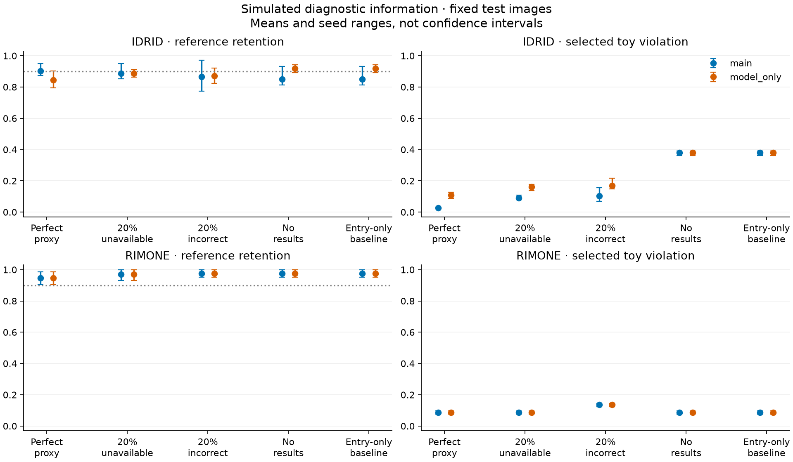

# Conformal Pathways

[](https://github.com/asguinea/conformal-pathways/actions/workflows/ci.yml)
[](LICENSE)

**Reproducible experiments for uncertainty-aware, result-aware decision workflows.**

Conformal Pathways studies what happens when a decision process can choose a
diagnostic action, receive its result, and update later decisions. It combines
small branching workflows, group-aware conformal calibration, candidate-path
filtering, and an evaluation harness that measures reference retention,
selected-rule violations, abstention, and test usage separately.

The examples use two illustrative retinal workflows with 18 complete sequences
each. Their rules and diagnostic outcomes are **research simulations**, not
validated clinical recommendations. APIs remain experimental in version 0.4.0.

## What you can do

- Run generated-data examples offline, without datasets, weights, or credentials.
- Inspect decision/result traces: a result is revealed only after its diagnostic
  action is committed, and skipped tests reveal nothing.
- Compare filtering and selection under perfect, unavailable, and incorrect
  simulated diagnostic information, using matched models and splits.
- Verify published aggregate evidence and reproduce the frozen experiments.

## Quick start

Use Python 3.12 and [uv](https://docs.astral.sh/uv/getting-started/installation/):

```sh
git clone https://github.com/asguinea/conformal-pathways.git
cd conformal-pathways
uv sync --locked
uv run --locked conformal-pathways sequential-demo --workflow dr --n 100 --seed 0
uv run --locked conformal-pathways sequential-demo --workflow glaucoma --n 100 --seed 0
uv run --locked pytest -q
```

Installation accesses the package registry. The demos then run offline on
synthetic data and print JSON with calibration, traces, and experimental metrics.
The class-frequency demo predictor checks software behavior; its outputs are
not evidence of predictive performance. The `demo` command exercises the
entry-only baseline. Optional image and plotting dependencies are documented in
[development](docs/development.md).

## Results and their limits

The frozen result-aware evaluation includes **11,392 synthetic comparisons and
400 real-image simulation comparisons**. Both suites reproduced exactly in
separate installed-wheel environments on the recorded Mac, including freshly
extracted features. This is same-host reproduction, not a claim of identical
results across hardware or operating systems.



For IDRiD with perfect simulated proxy information, main filtering reduces the
18 possible sequences to 1.69 on average, retains the designated acceptable
reference in 90.39% of cases, and abstains in 4.71%. Much of the reduction in
selected violations comes from the diagnostic information itself: an informed
unfiltered selector already performs similarly on that metric. RIM-ONE shows
smaller candidate sets without improving the score selector's violation rate.
Incorrect results can worsen decisions. These are means across five seeds with
fixed test images; seed ranges are not confidence intervals.

The diagnostic responses are retrospective label proxies, not measured test
responses. Reference retention is not a selected-action safety guarantee.
Patient linkage and exchangeability remain unverified. The evidence supports
specific descriptive trade-offs, not clinical safety or universal superiority.

- [Results and limitations](docs/batch-3-sequential-results.md)
- [Complete aggregate evidence](evidence/batch3-sequential-v1/README.md)
- [Verification record](docs/batch-3-sequential-verification.md)
- [Claim register](docs/claims.md)

## Reproduce or extend

Start with [the reproduction guide](docs/reproducing.md). Table verification
needs no private artifacts or external datasets. Full real-image reruns require
independently obtained IDRiD and RIM-ONE data under their provider terms.

The scientific Python source in 0.4.0 is unchanged from the evaluated snapshot.
Historical experiment locks include packaging metadata, so reproduce recorded
runs from `sequential-benchmark-v1` (0.4.0.dev0) or `baseline-entry-v2`
(0.3.0.dev0), using their matching wheels. The preserved entry-only benchmark is
a separate baseline; its negative findings and input exclusions remain available.
Do not refresh a frozen lock to run it against a different checkout.

See [the sequential method](docs/sequential-method.md), [toy rules](docs/toy-rules.md),
[prospective protocol](docs/sequential-experiment-protocol.md), and
[dataset evidence](docs/dataset-evidence.md) for assumptions and data semantics.

## Project layout

```text
src/conformal_pathways/
  sequential/   Result-aware sessions, calibration, simulation, evaluation
  conformal/    Entry-only calibration and filtering baseline
  benchmarks/   Frozen designs, paired experiments, evidence verification
  workflows/    Small branching states and actions
  safety/       Illustrative rule predicates and reference paths
  data/         Sample schema, manifests, grouped splits
  ingest/       Adapters for externally obtained datasets
  features/     Optional image features and cache provenance
  models/       Class-prior and embedding predictors
  scoring/      Experimental action scores
  eval/         Metrics, baseline runners, selectors, traces
  plots/        Research figures
```

The `safety` module name refers to the toy rule checker. It does not measure
clinical outcomes. Tests use generated fixtures; raw data and local experiments
are excluded from the repository and package distributions.

## Contributing, citation, and license

Read [CONTRIBUTING.md](CONTRIBUTING.md), [SECURITY.md](SECURITY.md), and
[development commands](docs/development.md). Cite the software using
[CITATION.cff](CITATION.cff) and the exact version or commit used.

Code and original documentation are licensed under [Apache 2.0](LICENSE).
[NOTICE](NOTICE) credits the external research datasets. No dataset images,
source annotations, patient manifests, embeddings, or model weights are
redistributed. Dataset and pretrained-model terms remain separate from the code
license; see [provenance](docs/provenance.md) and
[dependency licenses](docs/dependency-licenses.md).
