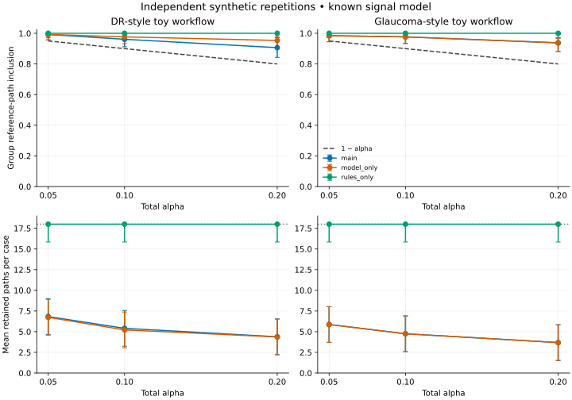

# Recorded experiment results

Generated from the complete records in `trials.jsonl`. All outcomes refer to toy rules.
Synthetic intervals use independent repetitions. Real-data ranges describe five training/calibration splits with a fixed official test set; they are not confidence intervals.

## Primary synthetic setting (alpha = 0.1, known signal model)

| Workflow | Variant | Group reference inclusion [95% Wilson interval] | Mean paths |
| --- | --- | --- | --- |
| dr | main | 0.961 [0.912, 0.983] | 5.40 |
| dr | model_only | 0.977 [0.933, 0.992] | 5.21 |
| dr | rules_only | 1.000 [0.971, 1.000] | 18.00 |
| dr | no_conformal | 1.000 [0.971, 1.000] | 18.00 |
| glaucoma | main | 0.977 [0.933, 0.992] | 4.75 |
| glaucoma | model_only | 0.977 [0.933, 0.992] | 4.75 |
| glaucoma | rules_only | 1.000 [0.971, 1.000] | 18.00 |
| glaucoma | no_conformal | 1.000 [0.971, 1.000] | 18.00 |

The complete tables also contain class-prior controls, missing-label and tiny-calibration scenarios, paired differences, selection violation rates, abstentions, and unavailable counts. Mean and paired-difference intervals use conservative Hoeffding bounds over independent repetitions. Intervals are pointwise; there is no multiplicity-adjusted superiority claim.

## Real-data descriptive checks (alpha = 0.1, frozen ResNet-50 features)

| Dataset | Variant | Reference inclusion mean (seed range) | Mean paths | Selected toy violation, observed-rules-first |
| --- | --- | --- | --- | --- |
| idrid | main | 0.849 (0.814–0.931) | 4.54 | 0.600 |
| idrid | model_only | 0.920 (0.892–0.941) | 5.83 | 0.600 |
| idrid | rules_only | 1.000 (1.000–1.000) | 18.00 | 0.618 |
| idrid | no_conformal | 1.000 (1.000–1.000) | 18.00 | 0.618 |
| rimone | main | 0.975 (0.952–1.000) | 5.15 | 0.258 |
| rimone | model_only | 0.975 (0.952–1.000) | 5.15 | 0.258 |
| rimone | rules_only | 1.000 (1.000–1.000) | 18.00 | 0.356 |
| rimone | no_conformal | 1.000 (1.000–1.000) | 18.00 | 0.356 |

Patient linkage and dataset exchangeability are unverified. These image-level descriptive results do not establish a patient-level coverage guarantee, treatment benefit, or clinical safety. The reference target uses retrospective proxies; no diagnostic response is observed.

Reproduction instructions, input provenance, exclusions, and dataset acknowledgments are in [the protocol](../../docs/experiment-protocol.md) and [dataset evidence](../../docs/dataset-evidence.md).
